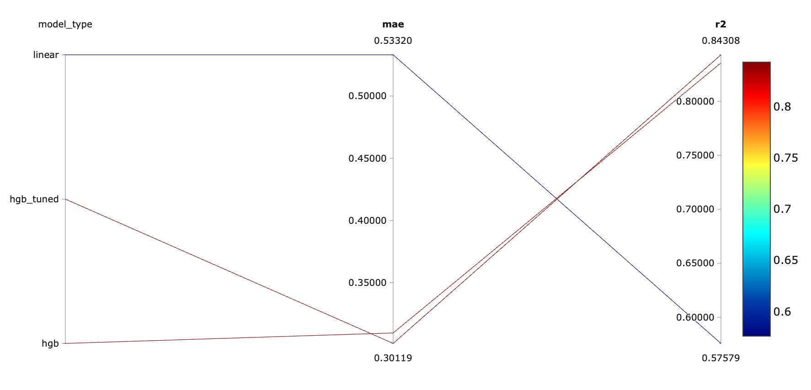

# 🏡 California House Price Predictor API


A production-style machine learning service that serves a scikit-learn regression model through a REST API built with **FastAPI**. Experiments are tracked with **MLflow**, the code is tested with **pytest**, and the service is packaged with **Docker**.

This service was built from my [ML service template](#-using-this-as-a-template), originally created for a breast cancer classifier, which shows that the same structure can serve different model types with minimal changes.

🚀 Live API: https://ml-api-deployment-regression.onrender.com/docs

(FYI: Hosted on Render's free tier; the first request after a period of inactivity may take up to a minute while the service wakes up.)

---

## ✨ Features

- **Single pipeline artifact**: preprocessing (`StandardScaler`) and model (`HistGradientBoostingRegressor`) are saved together, preventing training–serving skew
- **Business-ready output**: predictions are converted from the dataset's $100,000 units into US dollars and rounded to the nearest $1,000
- **Input validation** with Pydantic: malformed or incomplete requests are rejected with a clear `422` error before reaching the model
- **Model loaded once at startup** using FastAPI's lifespan, not on every request
- **Experiment tracking** with MLflow (optional): parameters, metrics and model artifacts are logged for each candidate model, and the selected model is versioned in the MLflow Model Registry
- **Unit and API tests** with pytest and FastAPI's `TestClient`, including behavioural tests of the model
- **Continuous integration** with GitHub Actions: linting, formatting checks, tests and a Docker build on every push and pull request
- **Reproducible Docker image**: the model is trained during the image build, so the scikit-learn version used for training always matches the one used for serving
- **Interactive API docs**, generated automatically at `/docs`

---

## 📁 Project Structure

```
├── .github/workflows/
│   └── ci.yml           # CI: ruff lint/format, tests, Docker build
├── src/app/
│   ├── main.py          # FastAPI app: /health and /predict endpoints
│   ├── schemas.py       # Pydantic request/response models
│   ├── model.py         # Model loading and prediction logic
│   └── config.py        # Paths, model version and target units
├── training/
│   └── train.py         # Trains a candidate model, saves the artifact, optionally logs to MLflow
├── models/              # Saved model artifact (not tracked in git)
├── tests/
│   ├── test_model.py    # Unit tests for the prediction logic
│   └── test_api.py      # API tests for the endpoints
├── docs/
│   └── mlflow-comparison.png  # MLflow run comparison screenshot
├── mlflow.db            # MLflow tracking database (runs and model registry)
├── mlruns/              # MLflow logged model artifacts
├── Dockerfile
├── pyproject.toml       # pytest and ruff configuration
└── requirements.txt
```

---

## 🧠 Model

| | |
|---|---|
| **Dataset** | California Housing (scikit-learn), 20,640 block groups, 8 features |
| **Target** | Median house value, in units of $100,000 (capped at $500,000) |
| **Pipeline** | `StandardScaler` → `HistGradientBoostingRegressor` |
| **Split** | 80/20, random (`random_state=42`) |
| **MAE** | 0.310 (≈ **$31,000** average error) |
| **R²** | 0.836 |
| **Version** | 1.0.0 (`house-price-regressor` in the MLflow Model Registry) |

**Features:**

| Feature | Description |
|---|---|
| `MedInc` | Median income in the block group (in $10,000s) |
| `HouseAge` | Median house age in the block group |
| `AveRooms` | Average number of rooms per household |
| `AveBedrms` | Average number of bedrooms per household |
| `Population` | Block group population |
| `AveOccup` | Average number of household members |
| `Latitude` | Block group latitude |
| `Longitude` | Block group longitude |

---

## 🧪 Experiments

Model selection was tracked with **MLflow**. Each training run logs its parameters, metrics and model artifact, and the chosen model is versioned in the MLflow Model Registry.

| Model (`--model`) | MAE | R² | Notes |
|---|---|---|---|
| Linear Regression (`linear`) | ~$53,300 | 0.576 | Baseline |
| HistGradientBoosting (`hgb`) | ~$31,000 | 0.836 | **Selected (v1.0.0)** |
| HistGradientBoosting, tuned (`hgb_tuned`) | ~$30,100 | 0.843 | 300 iterations, learning rate 0.05; 2× model size |



**Decision:** gradient boosting cut the average error by 42% compared with the linear baseline, by capturing non-linear effects such as location. The tuned variant improved MAE by only ~$840 (under 3%) while doubling the model size, so the simpler model was chosen.

**Caveat:** models were compared on the same test set used for reporting, so the selected model's score may be slightly optimistic. A stricter setup would select on a validation set or with cross-validation and report the test score once.

### 🔁 Reproducing the experiment

Tracking is optional, so the Docker build and CI run without MLflow installed:

```bash
pip install mlflow
python training/train.py --model linear --track
python training/train.py --model hgb --track
python training/train.py --model hgb_tuned --track
mlflow ui --port 5001
```

Each run overwrites `models/regressor.joblib`, so run `python training/train.py` (defaults to `hgb`) last to restore the served model.

---

## 🚀 Quickstart

### 🐳 Option 1: Run with Docker (recommended)

```bash
docker build -t house-price-api .
docker run -p 8000:8000 house-price-api
```

Note: the dataset is downloaded during the build, so an internet connection is required.

### 💻 Option 2: Run locally

```bash
python -m venv .venv
source .venv/bin/activate        # Windows: .venv\Scripts\activate
pip install -r requirements.txt

python training/train.py         # trains the selected model (hgb) and saves it
uvicorn app.main:app --reload --app-dir src
```

Then open **http://127.0.0.1:8000/docs** to explore the API interactively.

---

## 🔌 API Usage

### 🩺 `GET /health`

Checks that the service is running.

```json
{ "status": "ok" }
```

### 🏠 `POST /predict`

Accepts the 8 block-group features and returns the predicted median house value in US dollars.

**Request:**

```json
{
  "MedInc": 8.3252,
  "HouseAge": 41.0,
  "AveRooms": 6.984127,
  "AveBedrms": 1.02381,
  "Population": 322.0,
  "AveOccup": 2.555556,
  "Latitude": 37.88,
  "Longitude": -122.23
}
```

**Response:**

```json
{
  "predicted_price_usd": 426000.0,
  "model_version": "1.0.0"
}
```

If a feature is missing or has the wrong type, the API returns `422 Unprocessable Entity` with details of the invalid field.

---

## ✅ Running Tests

The tests load the saved model, so train it first:

```bash
python training/train.py
python -m pytest -v
```

The test suite covers:
- **Prediction contract**: output keys, a positive float price, and rounding to the nearest $1,000
- **Known-answer test with tolerance**: a house worth $452,600 is predicted between $300,000 and $600,000, which catches unit-conversion errors while still allowing the model to be retrained
- **Directional behaviour**: a higher median income predicts a higher price, as domain knowledge suggests
- **API behaviour**: health check, a valid prediction request end to end, and `422` rejection of a request with a missing feature

---

## ⚙️ Continuous Integration

GitHub Actions ([`ci.yml`](.github/workflows/ci.yml)) runs on every push to `main` and on every pull request:

1. **Lint**: `ruff check .` and `ruff format --check .`
2. **Test**: install dependencies, train the model, run `pytest`
3. **Docker**: build the image (only if lint and tests pass)

---

## 🧭 Design Decisions

- **Why convert to dollars inside the service?** API consumers read numbers literally. Returning `4.26` would require every client to know the dataset's units; returning `426000` in a field named `predicted_price_usd` removes that ambiguity.
- **Why round to the nearest $1,000?** With an average error of around $31,000, returning a price to the cent would suggest far more precision than the model has.
- **Why snake_case fields with PascalCase aliases?** Python code follows PEP 8 (`med_inc`), while clients send the dataset's original column names (`MedInc`). Pydantic's `to_pascal` alias generator maps between the two, so the pipeline receives the exact column names it was trained on.
- **Why tolerance-based tests instead of exact values?** An exact-value test breaks every time the model is legitimately improved. Ranges and directional checks catch real bugs without blocking model updates — the switch from linear regression to gradient boosting passed the same tests unchanged.
- **Why make MLflow optional?** Tracking is only needed while comparing models. Keeping it out of `requirements.txt` keeps the serving image small and lets CI and the Docker build run without a tracking server.
- **Why train inside the Docker build?** A `.joblib` artifact may not load correctly under a different scikit-learn version. Training in the image keeps both versions identical and lets the image be built from the repository alone. For larger models, the artifact would instead be pulled from the model registry.

---

## 🧩 Using This as a Template

The project separates **reusable infrastructure** from **model-specific code**, so a new model can be served by changing only a handful of files.

**Reusable (unchanged between models):**
- `src/app/main.py`: API endpoints, lifespan and model loading (only the app title changes)
- `Dockerfile`, `.dockerignore`, `pyproject.toml`, `.github/workflows/ci.yml`
- The MLflow tracking hook in `training/train.py` (`--track`)
- The structure of the tests: fixtures, `TestClient` setup and the 422 validation pattern

**Model-specific (change for each new model):**

| File | What to change |
|---|---|
| `training/train.py` | Dataset, candidate models (`MODELS`), evaluation metrics |
| `src/app/config.py` | Artifact filename, model version, target units |
| `src/app/model.py` | How the raw prediction is turned into the response |
| `src/app/schemas.py` | Input features and output fields |
| `tests/` | Sample data and model-specific assertions |

**Steps to create a new service:**
1. Click **"Use this template"** on GitHub to create a new repository.
2. Update the model-specific files listed above.
3. Run `python training/train.py`, then `python -m pytest -v`.
4. Build and run the Docker image.
